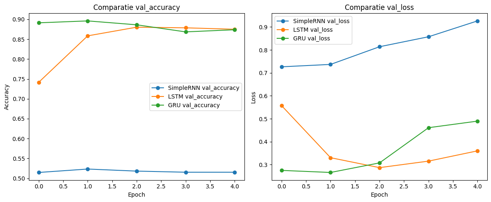

# IMDB Sentiment Analysis — SimpleRNN vs LSTM vs GRU

Binary sentiment classification of IMDB movie reviews with TensorFlow/Keras. Three recurrent architectures are compared, and gated models (LSTM, GRU) beat a plain SimpleRNN by about 36 percentage points of test accuracy.

## Problem
Given the raw text of a movie review, predict whether it is **positive (1)** or **negative (0)**. The goal is to show how the choice of recurrent layer affects learning on long text sequences when the data, preprocessing and training setup stay the same.

## Data
- **Source:** [IMDB Dataset (Sentiment Analysis) in CSV format — Kaggle (columbine)](https://www.kaggle.com/datasets/columbine/imdb-dataset-sentiment-analysis-in-csv-format)
- **Size:** 50,000 English reviews, already split into `Train.csv` (40,000), `Valid.csv` (5,000) and `Test.csv` (5,000). Columns are `text` and `label`, and each split is about 50% positive.
- The CSVs (~66 MB in total) are not included. See [`data/README.md`](data/README.md).

## Approach
- **Preprocessing:** Keras `TextVectorization` with a vocabulary of 10,000 words, integer token IDs and sequences padded or truncated to 300 tokens. The vocabulary is learned on the training set only.
- **Shared architecture:** `TextVectorization` → `Embedding(10,000, 128)` → **recurrent layer (64 units)** → `Dense(64, ReLU)` → `Dense(1, sigmoid)`, trained with Adam and binary cross-entropy for 5 epochs at batch size 32.
- **Model 1, SimpleRNN:** no padding mask.
- **Model 2, LSTM:** `mask_zero=True`, so padding is ignored. Seed 42.
- **Model 3, GRU:** `mask_zero=True`. Seed 42.
- **Evaluation:** accuracy and loss on the held-out test set, validation curves, and predictions on a few new example sentences.

## Results

| Model | Best val accuracy | Test accuracy | Test loss | Δ test accuracy vs SimpleRNN |
|---|---|---|---|---|
| SimpleRNN | 0.5234 | 0.5120 | 0.9303 | — |
| **LSTM** | 0.8802 | **0.8794** | **0.3439** | **+0.3674** |
| GRU | **0.8960** | 0.8740 | 0.4849 | +0.3620 |



- SimpleRNN stays at chance level, about 51%. Its validation loss rises every epoch, and it outputs nearly the same probability (~0.49) for every example review.
- GRU learns fastest, reaching 0.8912 validation accuracy after one epoch. Its validation loss rises after epoch 2, though, a sign of overfitting.
- LSTM ends with the best test accuracy and the lowest test loss.

## Key takeaway
**The recurrent cell matters more than anything else in this setup.** On 300-token reviews a plain SimpleRNN cannot carry information across the sequence. It also learns from the padding, so it performs no better than a coin flip. Gated cells (LSTM and GRU) combined with padding masks reach about 87–88% test accuracy with the same data, vocabulary and training budget. LSTM is marginally better on the test set, and GRU peaks higher on validation.

## How to run
```bash
git clone https://github.com/mihaimiron1/imdb-sentiment-rnn-lstm-gru.git
cd imdb-sentiment-rnn-lstm-gru
pip install -r requirements.txt jupyter
# download Train.csv, Valid.csv, Test.csv from Kaggle into data/
jupyter notebook notebooks/imdb_sentiment.ipynb
```

## Project structure
```
├── data/                          # Train.csv, Valid.csv, Test.csv go here (not tracked)
├── images/                        # charts extracted from the notebook outputs
├── notebooks/imdb_sentiment.ipynb
└── requirements.txt
```

## Next steps
- Add EarlyStopping on validation loss, since GRU and LSTM both start overfitting after 2–3 epochs
- Try a bidirectional LSTM or GRU, pre-trained embeddings such as GloVe, or a 1D-CNN baseline
- Compare with a fine-tuned transformer (e.g. DistilBERT) as an upper bound
- Report precision, recall, F1 and a confusion matrix, not just accuracy

---
Developed as part of the Artificial Intelligence course at the Technical University of Moldova.

**Author:** Mihai Miron
